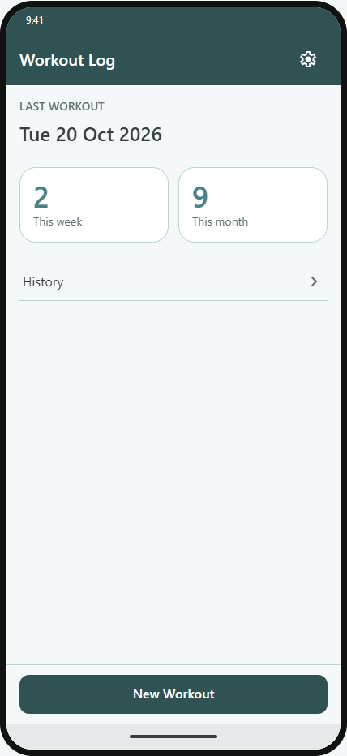
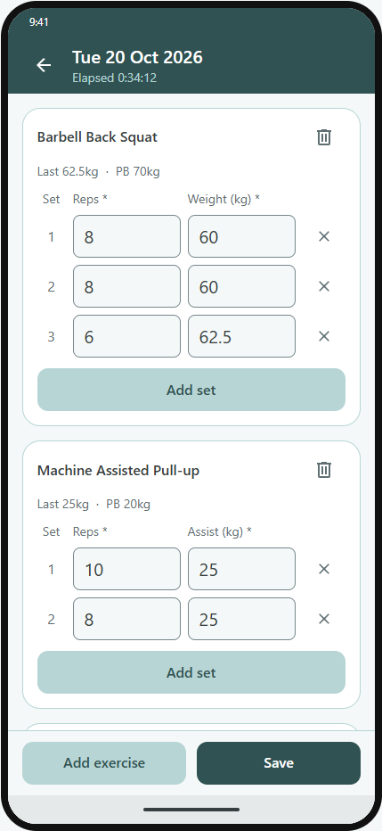
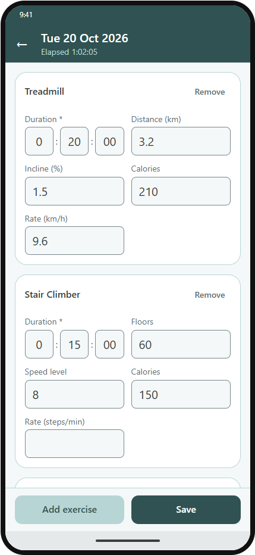
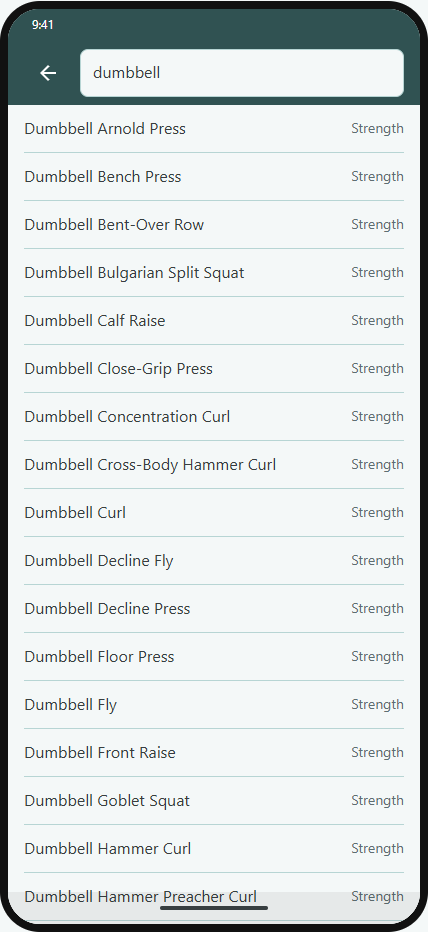
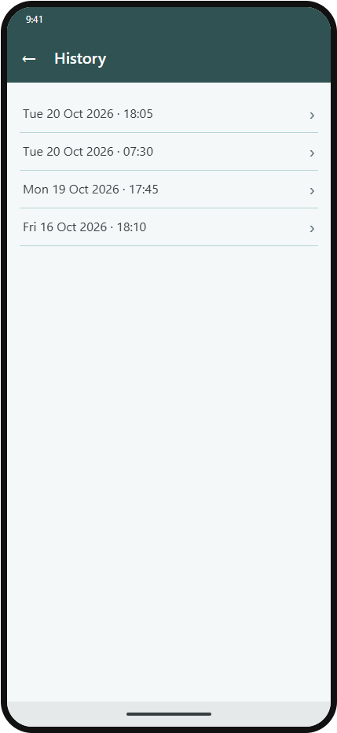

<div align="center">


# Workout Log

**A paper gym notebook, rebuilt as a fast, offline Android app.**

[](https://github.com/marty-shields/workout-log-app/actions/workflows/pr-build.yml)
[](https://github.com/marty-shields/workout-log-app/releases/latest)
[](https://marty-shields.github.io/workout-log-app/)
[](LICENSE)


-34A853?logo=android&logoColor=white)


[Features](#features) · [Screenshots](#screenshots) · [Install](#install) · [Built with](#built-with) · [Getting started](#getting-started) · [License](#license)

</div>

---

## Why

Every gym session used to go in a paper notebook: date, start and finish times, exercises, sets, reps and weights. Workout Log keeps that simple flow and drops the paper. Open the app, add exercises, log sets as you go, then look back at past sessions.

It's built for one person and one phone: no accounts, no sign-up.

## Features

- 🏋️ **Log as you train.** Add exercises and record sets. The fields fit the exercise: reps and weight for Bench Press, duration for Plank, distance and weight for carries.
- 📚 **315 exercises built in.** Strength and cardio, searchable as you type.
- 🏃 **Cardio entries.** Duration plus each machine's own metrics: distance, incline, floors, level, calories, rate.
- ⏱️ **Automatic timing.** Start and finish times are captured for you, with a live timer while you log.
- 🗂️ **History.** Browse every session, open one to edit it, or delete it.
- 📊 **Dashboard.** Your last workout and how many sessions you've done this week and this month.
- ✅ **Clear checks.** Save checks every set and entry, and points to the exact field at fault.
- 🌗 **Light and dark.** Follows the phone's theme.
- ☁️ **Backup.** Supports Android Auto Backup, so your workouts come back on a new phone.

## Screenshots

<table align="center">
  <tr>
    <td align="center">
      <picture>
        <source media="(prefers-color-scheme: dark)" srcset="docs/images/readme/dashboard-dark.png" />
        
      </picture>
    </td>
    <td align="center">
      <picture>
        <source media="(prefers-color-scheme: dark)" srcset="docs/images/readme/new-workout-dark.png" />
        
      </picture>
    </td>
    <td align="center">
      <picture>
        <source media="(prefers-color-scheme: dark)" srcset="docs/images/readme/cardio-dark.png" />
        
      </picture>
    </td>
    <td align="center">
      <picture>
        <source media="(prefers-color-scheme: dark)" srcset="docs/images/readme/exercise-picker-dark.png" />
        
      </picture>
    </td>
    <td align="center">
      <picture>
        <source media="(prefers-color-scheme: dark)" srcset="docs/images/readme/history-dark.png" />
        
      </picture>
    </td>
  </tr>
  <tr>
    <td align="center"><sub><b>Dashboard</b></sub></td>
    <td align="center"><sub><b>Strength sets</b></sub></td>
    <td align="center"><sub><b>Cardio</b></sub></td>
    <td align="center"><sub><b>Exercise picker</b></sub></td>
    <td align="center"><sub><b>History</b></sub></td>
  </tr>
</table>

<p align="center"><sub>The screenshots match your GitHub theme. They're taken from the stories site, which renders the app's own components.</sub></p>

## Install

Workout Log is sideloaded: it isn't on Google Play.

1. Download `WorkoutLog-X.Y.Z.apk` from the [latest release](https://github.com/marty-shields/workout-log-app/releases/latest).
2. Check it's signed with the release key: `apksigner verify --print-certs WorkoutLog-X.Y.Z.apk` (Android SDK build tools) must show the SHA-256 digest at the top of the release notes.
3. Open it on the phone (allow your file manager to install apps), or run `adb install -r WorkoutLog-X.Y.Z.apk`. A newer version installs over the old one and keeps your workouts.

## Built with

| Area | Choice |
|---|---|
| App | [.NET MAUI Blazor Hybrid](https://learn.microsoft.com/dotnet/maui/user-interface/controls/blazorwebview) on .NET 10: Razor components in a native Android shell |
| Platform | Android 16 (API 36), sideloaded |
| Data | SQLite via sqlite-net-pcl, on the device |
| Design system | Design tokens, components and screens, documented in a [BlazingStory](https://github.com/jsakamoto/BlazingStory) stories site, [published on GitHub Pages](https://marty-shields.github.io/workout-log-app/) |
| Tests | NUnit unit tests, bUnit component tests, and end-to-end Gherkin features run by Reqnroll and Appium on a phone or emulator |
| CI | GitHub Actions builds and tests every pull request, end-to-end tests on emulators included; the release workflow runs them again, then signs and publishes the APK; Dependabot keeps packages current |

<details>
<summary><b>Project layout</b></summary>

```
src/
  WorkoutLog.App/          MAUI Blazor Hybrid host (Android): startup, DI, routing
  WorkoutLog.UI/           Razor class library: screens, components, design tokens
  WorkoutLog.UI.Stories/   BlazingStory stories site for the UI
  WorkoutLog.Core/         Exercise list, SQLite data, logging
tests/
  WorkoutLog.Core.Tests/   NUnit tests for Core
  WorkoutLog.UI.Tests/     bUnit tests for components and screens
  WorkoutLog.E2E.Tests/    Gherkin features on a device (Reqnroll + Appium)
```

</details>

## Getting started

You need the .NET 10 SDK with the `maui-android` workload. The full setup, including the Android SDK and the phone, is in [Dev setup & build](docs/06-dev-setup-build.md).

```powershell
# Build (warnings fail the build)
dotnet build WorkoutLog.slnx

# Run the unit and component tests
dotnet test tests/WorkoutLog.Core.Tests
dotnet test tests/WorkoutLog.UI.Tests

# Browse the stories site at http://localhost:5056 (main is at https://marty-shields.github.io/workout-log-app/)
dotnet run --project src/WorkoutLog.UI.Stories

# Run on a connected Android phone
dotnet build src/WorkoutLog.App -t:Run -f net10.0-android
```

The end-to-end tests need a connected device or an emulator: see [E2E tests](docs/06-dev-setup-build.md#e2e-tests).

## License

[MIT](LICENSE)
