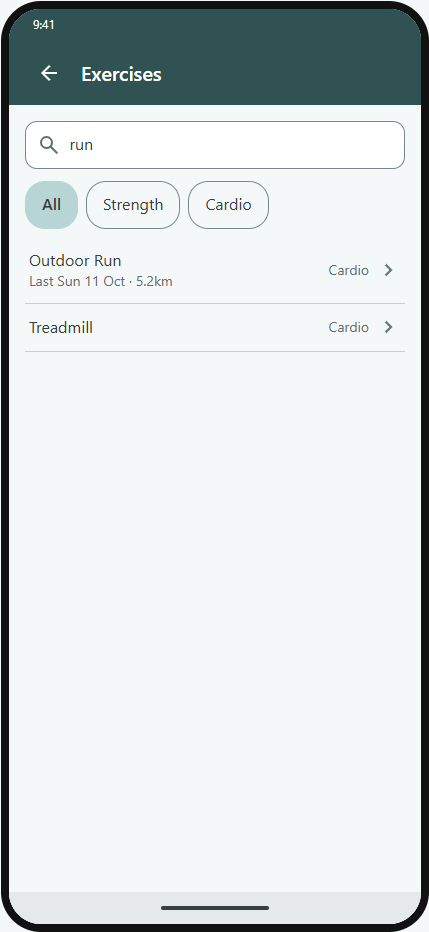
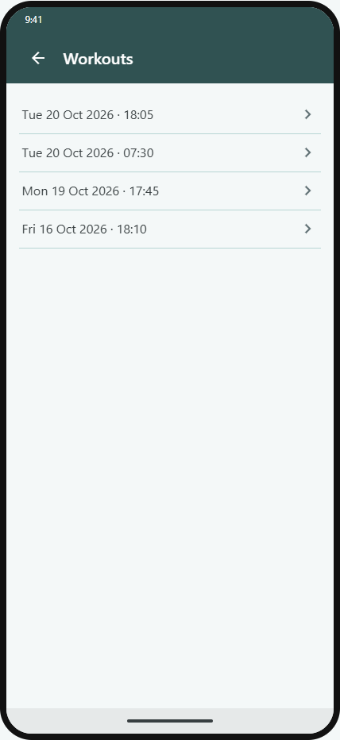
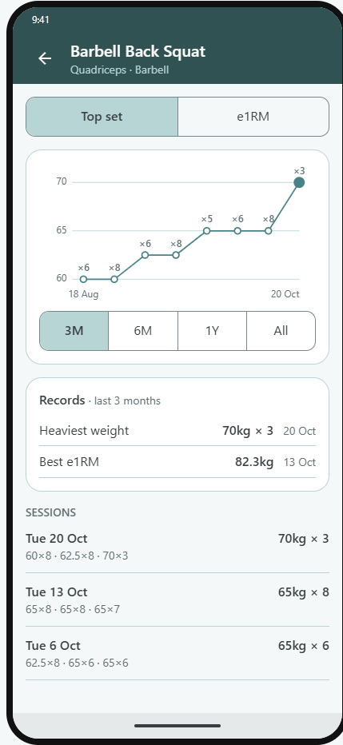
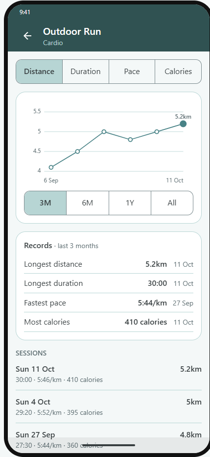
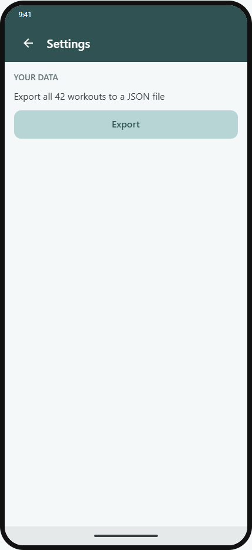

<div align="center">


# Workout Log

**A paper gym notebook, rebuilt as a fast, offline Android app.**

[](https://github.com/marty-shields/workout-log-app/releases/latest)
-34A853?logo=android&logoColor=white)


[](https://marty-shields.github.io/workout-log-app/)
[](LICENSE)

[Features](#features) · [Install](#install) · [Built with](#built-with) · [Getting started](#getting-started) · [License](#license)

</div>

---

## Why

Every gym session used to go in a paper notebook: date, start and finish times, exercises, sets, reps and weights. Workout Log keeps that simple flow and drops the paper. Open the app, add exercises, log sets as you go, then look back at past sessions.

It's built for one person and one phone: no accounts, no sign-up.

## Features

### Logging

- Add exercises and log sets. Each exercise shows the fields it needs: reps and weight, duration, or distance.
- 315 built-in strength and cardio exercises, with search.
- Cardio entries record duration plus the machine's metrics: distance, incline, floors, level, calories and rate.
- Start and finish times are recorded for you, with a timer while you log.
- Saving checks every set and points to the field that's wrong.

<table align="center">
  <tr>
    <td align="center">
      <picture>
        <source media="(prefers-color-scheme: dark)" srcset="docs/images/readme/new-workout-dark.png" />
        
      </picture>
    </td>
    <td align="center">
      <picture>
        <source media="(prefers-color-scheme: dark)" srcset="docs/images/readme/cardio-dark.png" />
        
      </picture>
    </td>
    <td align="center">
      <picture>
        <source media="(prefers-color-scheme: dark)" srcset="docs/images/readme/add-exercise-dark.png" />
        
      </picture>
    </td>
  </tr>
  <tr>
    <td align="center"><sub><b>Strength sets</b></sub></td>
    <td align="center"><sub><b>Cardio</b></sub></td>
    <td align="center"><sub><b>Add exercise</b></sub></td>
  </tr>
</table>

### Progress

- Workouts lists every session; open one to edit or delete it.
- Exercises lists every exercise you've logged, with its last session and best.
- Each exercise has a chart, records and its sessions over 3 months, 6 months, a year or all time:
  - lifts: top set and estimated one-rep max
  - bodyweight moves: best set, total reps and top set
  - assisted machines: least assist
  - holds: duration and weight
  - carries: weight and distance
  - cardio: distance, duration, pace or speed, floors and calories

<table align="center">
  <tr>
    <td align="center">
      <picture>
        <source media="(prefers-color-scheme: dark)" srcset="docs/images/readme/workouts-dark.png" />
        
      </picture>
    </td>
    <td align="center">
      <picture>
        <source media="(prefers-color-scheme: dark)" srcset="docs/images/readme/exercise-lift-dark.png" />
        
      </picture>
    </td>
    <td align="center">
      <picture>
        <source media="(prefers-color-scheme: dark)" srcset="docs/images/readme/exercise-cardio-dark.png" />
        
      </picture>
    </td>
  </tr>
  <tr>
    <td align="center"><sub><b>Workouts</b></sub></td>
    <td align="center"><sub><b>Lift progress</b></sub></td>
    <td align="center"><sub><b>Cardio progress</b></sub></td>
  </tr>
</table>

### Dashboard and data

- The Dashboard shows your last workout, this week against last week up to the same day and time, a bar per week for the last 12 weeks and your weekly streak.
- Recent records on the Dashboard shows the exercises you've beaten your best on in the last 30 days; tap one to open its progress.
- Export saves every workout to a JSON file you can share.
- Import reads an exported file, shows what's new, already there or different, and adds or replaces them.
- Android Auto Backup restores your workouts on a new phone.
- Light and dark themes follow the phone.

<table align="center">
  <tr>
    <td align="center">
      <picture>
        <source media="(prefers-color-scheme: dark)" srcset="docs/images/readme/dashboard-dark.png" />
        
      </picture>
    </td>
    <td align="center">
      <picture>
        <source media="(prefers-color-scheme: dark)" srcset="docs/images/readme/settings-dark.png" />
        
      </picture>
    </td>
  </tr>
  <tr>
    <td align="center"><sub><b>Dashboard</b></sub></td>
    <td align="center"><sub><b>Export and import</b></sub></td>
  </tr>
</table>

## Install

Workout Log is sideloaded: it isn't on Google Play.

1. Download `WorkoutLog-X.Y.Z.apk` from the [latest release](https://github.com/marty-shields/workout-log-app/releases/latest).
2. Check it's signed with the release key: `apksigner verify --print-certs WorkoutLog-X.Y.Z.apk` (Android SDK build tools) must show the SHA-256 digest at the top of the release notes.
3. Open it on the phone (allow your file manager to install apps), or run `adb install -r WorkoutLog-X.Y.Z.apk`. A newer version installs over the old one and keeps your workouts.

## Built with

| Area | Choice |
|---|---|
| App | [.NET MAUI Blazor Hybrid](https://learn.microsoft.com/dotnet/maui/user-interface/controls/blazorwebview) on .NET 10: Razor components in a native Android shell |
| Platform | Android 16 (API 36), sideloaded |
| Data | SQLite via sqlite-net-pcl, on the device |
| Design system | Design tokens, components and screens, documented in a [BlazingStory](https://github.com/jsakamoto/BlazingStory) stories site, [published on GitHub Pages](https://marty-shields.github.io/workout-log-app/) |
| Tests | NUnit unit tests, bUnit component tests, and end-to-end Gherkin features run by Reqnroll and Appium on a phone or emulator |
| CI | GitHub Actions builds and tests every pull request, end-to-end tests on emulators included; the release workflow runs them again, then signs and publishes the APK; Dependabot keeps packages current |

<details>
<summary><b>Project layout</b></summary>

```
src/
  WorkoutLog.App/          MAUI Blazor Hybrid host (Android): startup, DI, routing
  WorkoutLog.UI/           Razor class library: screens, components, design tokens
  WorkoutLog.UI.Stories/   BlazingStory stories site for the UI
  WorkoutLog.Core/         Exercise list, SQLite data, logging
tests/
  WorkoutLog.Core.Tests/   NUnit tests for Core
  WorkoutLog.UI.Tests/     bUnit tests for components and screens
  WorkoutLog.E2E.Tests/    Gherkin features on a device (Reqnroll + Appium)
```

</details>

## Getting started

You need the .NET 10 SDK with the `maui-android` workload. The full setup, including the Android SDK and the phone, is in [Dev setup & build](docs/dev-setup-build.md).

```powershell
# Build (warnings fail the build)
dotnet build WorkoutLog.slnx

# Run the unit and component tests
dotnet test tests/WorkoutLog.Core.Tests
dotnet test tests/WorkoutLog.UI.Tests

# Browse the stories site at http://localhost:5056 (main is at https://marty-shields.github.io/workout-log-app/)
dotnet run --project src/WorkoutLog.UI.Stories

# Run on a connected Android phone
dotnet build src/WorkoutLog.App -t:Run -f net10.0-android
```

The end-to-end tests need a connected device or an emulator: see [E2E tests](docs/dev-setup-build.md#e2e-tests).

## License

[MIT](LICENSE). 
Third-party notices are in [NOTICE](NOTICE).