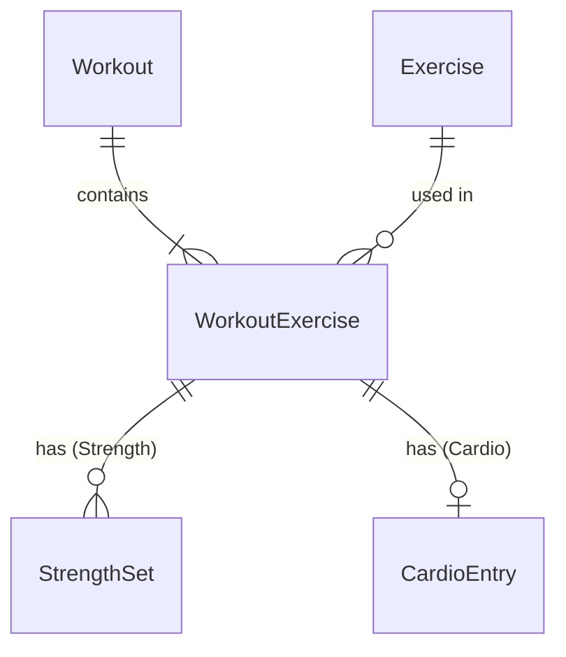

# 02 — Data Model

SQLite on the device, accessed through `IWorkoutRepository`, `IExerciseSeeder` and `IDatabaseInitializer` (D110). Their calls run one at a time (D106).

## Approach: hybrid tables per exercise type
- Strength and cardio data live in **separate tables**: `StrengthSet` and `CardioEntry`.
- Each table has **one nullable column per metric**.
- Each exercise in the fixed list declares **which metrics it shows and which are required**. The UI and validation read this definition.
- Adding a new exercise is a list entry. Adding a new kind of metric is a new column.

## Metrics

| Metric | Type | Strength | Cardio | Notes |
|---|---|---|---|---|
| Reps | int | ✓ | | > 0 |
| WeightKg | decimal | ✓ (always required) | | ≥ 0; 0 is unweighted or no assist (D23). Per dumbbell. Assistance on assisted machines |
| Duration | TimeSpan | ✓ (holds, carries: required) | ✓ (always required) | > 0. Whole seconds (D32). Entered as h:mm:ss |
| Distance | decimal | ✓ (carries: required) | ✓ (required where shown) | > 0. Unit from the exercise |
| Floors | int | | ✓ | > 0 when set |
| Level | int | | ✓ | > 0 when set, whole number. Resistance, damper or speed level, per the exercise's label |
| Incline | decimal | | ✓ | ≥ 0, percent |
| Calories | int | | ✓ | > 0 when set, whole number |
| Rate | decimal | | ✓ | > 0 when set, unit from the exercise (e.g. steps/min) |

Which metrics each exercise shows and requires: [03](03-exercise-list.md#activity-types). A blank optional metric means not recorded. Decimal metrics (weight, distance, incline, rate) have at most 2 decimal places (D29). Each metric has a maximum (D33, `MetricLimits`): reps 1,000; weight 1,000 kg; duration 23:59:59; distance 1,000 km or 100,000 m or ft; floors 1,000; level 100; incline 100 %; calories 10,000; rate 300 rpm, 200 strokes/min, 300 strides/min, 300 steps/min, 1,000 ft/min.

Pace (Outdoor Run, Outdoor Walk) and speed (Treadmill, Outdoor Cycle) are worked out from distance and duration by `WorkedOut`, never typed or stored: pace = duration ÷ distance in km, speed = distance in km ÷ hours (D197). They are compared and charted unrounded, and shown rounded, halves away from zero: pace to the second (*5:46/km*), speed to 2 decimal places (*10.4 km/h*).

The database stores `decimal` as REAL (floating point), `TimeSpan` as ticks and `DateTimeOffset` as UTC ticks.

Decimals are shown, edited and exported rounded to 2 places, halves away from zero, through one helper, `Decimals.Round2`: a stored 62.4999… is 62.5 (D29, D47).

## Exercise definition (Core project)
The definitions are an embedded JSON file in Core, from [exercises.json](../src/WorkoutLog.Core/Domain/Exercises/exercises.json). It is loaded once at startup into `IExerciseCatalog`, a singleton that every screen and service uses.

Each definition has an Id (one sequence for all exercises, never reused or changed; new exercises take the next number), a unique Name, a Type (`Strength` or `Cardio`), a Category (how its sets are measured, which picks its best: [03](03-exercise-list.md#fields-per-exercise)), Aliases (nicknames for search, unique across the list), the strength-only PrimaryMuscle, Equipment and Mechanic (values in [03](03-exercise-list.md#fields-per-exercise)), its Metrics (which show, which are required, and an optional field label), its DistanceUnit and RateUnit where it has those metrics, PaceUnit on an exercise with worked-out pace, RateUnit KmPerHour on one with worked-out speed (D19, D197), and Loaded, true on a bodyweight move whose Exercise page has an e1RM tab (D193).

## Exercise search
- At load, each exercise's name and aliases are split into words: lower case, apostrophes removed, and any other character that isn't a letter or digit as a space. These variants are replaced (D62):

| Word | Becomes |
|---|---|
| triceps, biceps | tricep, bicep |
| flies, flyes, flye | fly |
| pullup(s), pushup(s), chinup(s), situp(s), stepup(s) | pull up, push up, chin up, sit up, step up |
| ups | up |
| nordics | nordic |
| skullcrusher | skull crusher |

- A partly typed two-word variant is split as the full one would be: pullu → pull u, skullc → skull c (D62).
- A query is split the same way, after cutting it to 50 characters; the search box also takes at most 50. An exercise matches when every query word starts a word of its name or aliases, in any order (D62).
- Order: name starts with the query, then other name matches, then matches that need an alias; A–Z within each. "Starts with": each query word, in order, starts the name's word in the same place, so "dumb curl" ranks Dumbbell Curl first (D63).
- With no search text: every exercise, Strength then Cardio, A–Z. The Exercises list instead keeps its own order (D191) and ranks its search results the same way, among the logged exercises.
- Search runs in memory on each keystroke. There is no search table in SQLite.

## Tables
- `Exercise`: Id, Name and Type only, so other tables can reference it. All other fields come from the definition file, so changing them never needs a schema change.
- `Workout`: `StartedAt` (set when New Workout opens, unique, D111) and `FinishedAt` (set on first save, the start plus the time New Workout was open, D199), both UTC and never changed after save; the finish is after the start. `StartedAt` identifies the workout across phones; the Id is used only inside one database (D186). A new workout whose start is already saved fails to save (`SaveFailed`). Date, day of week and total time are calculated from them in the phone's current time zone, not stored.
- `WorkoutExercise`: one per exercise in a workout, → Workout (indexed) and → Exercise, with its position. Workout and exercise together are **unique** (FR-04).
- `StrengthSet`: → WorkoutExercise (indexed), its position, and one column per strength metric; `WeightKg` is NOT NULL, the others nullable.
- `CardioEntry`: → WorkoutExercise, **unique** (one entry per exercise), and one nullable column per cardio metric; Duration is required.
- Positions are the order added or last picked, from 0 to 9. The workout screens show exercises newest first (D42).
- The four workout tables are created by SQL in `WorkoutTables`, with CHECK rules on each column (D200): `FinishedAt` > `StartedAt`; positions 0–9; reps 1–1,000; weight 0–1,000; durations 1 s–23:59:59 in whole seconds; distance over 0 up to 100,000; floors 1–1,000; level 1–100; incline 0–100; calories 1–10,000; rate over 0 up to 1,000; decimals with at most 2 places (`ROUND(x, 2) = x`); required columns are NOT NULL, and their rules also fail on NULL. They are written against the stored forms (ticks and REAL); the limits per exercise and unit stay in Core. Index names match sqlite-net's, and the ORM creates the `Exercise` table.

## Diagram



## Rules
- A saved workout has 1 to 10 WorkoutExercises, each exercise once. Each one has 1 to 10 StrengthSets (strength) or exactly one CardioEntry (cardio) (D198).
- The exercise type decides which child table is used.
- Deleting a workout deletes its WorkoutExercises, sets and entries. The database has no foreign keys or cascades, so the repository does these deletes in one transaction.
- Saving an edited workout replaces its WorkoutExercises, sets and entries in one transaction. The times are not changed (D110).
- Positions come from the order of the lists passed to the repository.
- The `→` references are enforced in code, not by the database.

## Validation
`WorkoutValidator` checks a workout against each exercise's definition before `IWorkoutService` saves it (FR-09, D113). It returns codes; the UI words them.

| Level | Code | When | Message (UI) |
|---|---|---|---|
| Workout | `NoExercises` | No exercises | Add at least one exercise |
| Workout | `SaveFailed` | The database write failed (D115) | Couldn't save the workout. Try again |
| Workout | `RepeatedExercise` | An exercise appears more than once (FR-04) | None; logged (D35) |
| Workout | `TooManyExercises` | More than 10 exercises (D198) | None; logged (D35) |
| Exercise | `UnknownExercise` | Id not in the list; its sets aren't checked | Exercise not found (on Save only, D35) |
| Exercise | `WrongType` | Strength for a cardio exercise or the other way round; its sets aren't checked | Exercise type doesn't match (on Save only, D35) |
| Exercise | `NoSets` | A strength exercise with no sets | Add at least one set |
| Exercise | `TooManySets` | A strength exercise with more than 10 sets (D198) | None; logged (D35) |
| Set / entry | `Missing` | A required metric is empty | Enter {label} |
| Set / entry | `NotPositive` | Any metric but weight and incline ≤ 0 | {Label} must be more than 0 |
| Set / entry | `Negative` | Weight or incline < 0 (D33) | {Label} must be 0 or more |
| Set / entry | `NotWholeSeconds` | A duration with part of a second (D32) | {Label} must be whole seconds |
| Set / entry | `TooManyDecimals` | More than 2 decimal places (D29) | None; logged (D35) |
| Set / entry | `TooLarge` | Above the metric's maximum (D33) | {Label} must be {max} or less |
| Set / entry | `NotShown` | A value for a metric the exercise doesn't show, e.g. a rate on Treadmill (D35) | None; logged (D35) |

`WorkoutErrors` holds every workout code that applies. At most one code per metric, in the order Missing, NotPositive or Negative, NotWholeSeconds, TooManyDecimals, TooLarge (D32). The codes the editor can't cause have no message: the editor keeps one of each exercise and at most 10 exercises and sets, and its format check allows 2 decimal places. They still fail the check and are logged as a Warning, 2502 for a field and 2601 or 2602 on Save. Entry formats are checked by the UI before it builds the records (below). A null list, exercise, set or entry is a programming error and throws `ArgumentNullException` (D35). The service validates and saves its own copy of the list (D107).

### Entry formats (UI)
`ISetChecker` puts 0 in a blank weight on a bodyweight move, assisted machine, hold or carry, then reads each field's text before Core checks the set or entry (D23, D123). A field with a format message gets no message from Core. On Save, `IWorkoutChecker` checks every set and entry, then the workout through `IWorkoutService.Validate` (D125).

| Field | Accepted | Message (UI) |
|---|---|---|
| Number | Digits, optionally `.` and digits; `.5`; leading zeros. Not `5.`, spaces, `+`, `-`, `,` or exponents (D28, D33) | {Label} must be a number |
| Decimal | At most 2 decimal places, counting typed digits (`22.500` fails) (D29) | {Label} can have up to 2 decimal places |
| Whole number | No `.` (D30) | {Label} must be a whole number |
| Duration | Three boxes of digits; an empty box is 0, all empty is empty (D31) | {Label} must be a time |
| Duration | Minutes and seconds 00–59 (D31) | {Label} minutes and seconds must be 00–59 |

A number too large for the set's types is capped (weight, distance, incline and rate at the largest decimal; reps, floors, level and calories at the largest int; duration just over 23:59:59), so Core reports `TooLarge`. The TooLarge message has no unit; a duration's maximum shows as 23:59:59 (D35, D31).

## Export file
`IExportService` writes every saved workout to one JSON file (FR-51, D188):
- Named `workout-log-YYYY-MM-DD-HHmm.json` in the phone's local time, in the app's cache folder; a file of the same name is replaced.
- UTF-8, camelCase, no indentation. At most 5 MB (5,242,880 bytes); a larger file isn't written.
- Header: `formatVersion` (2), `exportedAt` (UTC to the second, `yyyy-MM-ddTHH:mm:ssZ`), `appVersion` (the App's display version), then `workouts`.
- Workouts by start time, oldest first: `startedAt` and `finishedAt` (UTC, 7 fractional digits, `yyyy-MM-ddTHH:mm:ss.fffffffZ`), and `exercises` in position order.
- Each exercise: `exercise` with `id`, `name`, `type`, and `distanceUnit`, `rateUnit` and `paceUnit` where the exercise has them; then `sets` in the order added (strength) or `entry` (cardio). An id not in the exercise list is written as `{ "id": n }` only.
- Metrics use the names in [Metrics](#metrics), camelCase; ones with no value are left out, and every strength set has `weightKg`. Pace and speed aren't written. Decimals are JSON numbers rounded to 2 places; duration is `hh:mm:ss`.

```json
{"formatVersion":2,"exportedAt":"2026-10-26T18:05:12Z","appVersion":"1.4.0","workouts":[{"startedAt":"2026-10-21T17:05:00.1234567Z",
 "finishedAt":"2026-10-21T18:02:41.7654321Z","exercises":[
  {"exercise":{"id":8,"name":"Barbell Bench Press","type":"Strength"},"sets":[{"reps":8,"weightKg":60},{"reps":6,"weightKg":62.5}]},
  {"exercise":{"id":311,"name":"Outdoor Run","type":"Cardio","distanceUnit":"Km","paceUnit":"PerKm"},"entry":{"duration":"00:30:00","distance":5.2}}]}]}
```
(Line breaks added here for reading.)

## Import
`IImportService` reads a file made by Export (FR-52, D190):
- At most 5 MB (5,242,880 bytes): checked by the picked file's size when known, and by the read.
- **Not an export**: not JSON, not an object, no `workouts` list, `formatVersion` missing or not a whole number of 1 or more, `exportedAt` not `yyyy-MM-ddTHH:mm:ssZ`, `appVersion` missing or blank, or a header property the format doesn't have. A newer `formatVersion` than the app's is its own error; so is an empty `workouts` list.
- Each workout is read on its own, after the [format upgrades](#format-upgrades). One that can't be read (a missing or wrong-typed value, an exercise with both or neither of `sets` and `entry`, or a property the format doesn't have in the workout, an exercise, its `exercise` info, a set or the entry, such as `pace`) is **malformed**; the others still import.
- Then each workout is checked; it can't be imported when it is malformed, or:
  - `startedAt` is missing or not in the export's format, or another workout in the file has the same start (malformed ones count);
  - `finishedAt` is missing, not in the export's format, or not after the start;
  - an exercise id isn't in the exercise list, or an exercise's `type`, `distanceUnit`, `rateUnit` or `paceUnit` differs from the list's (missing or extra counts; names are ignored, D61);
  - an exercise appears more than once (FR-04); nothing is merged;
  - it fails Save's checks (FR-09, limits D33, D198), e.g. a strength set with no `weightKg`, more than 2 decimal places, or more than 10 sets or exercises.
- A workout that passes is **new** when no phone workout has its start (D186), **already on this phone** when one has it with the same contents, and **different** otherwise. Contents compare as the export writes them: finish to the tick, exercises and sets in order, decimals rounded to 2 places, durations to the second.
- **Add** adds the new ones; **Use the file's** replaces a different workout's finish, exercises, sets and entries. **Replace all** deletes every phone workout and adds every one that can be imported. Either runs in one transaction.

## Format upgrades
- An older `formatVersion` is upgraded on the whole file before it is read, by numbered steps (`IFormatUpgrade`) from 2, exactly one for each version up to the app's. Parts of the file without the export's shape are left for the reader.
- Step 2 (`ValidationRulesFormatUpgrade`, version 1 → 2): a strength set with no `weightKg` gets 0; `calories`, `level`, `rate` and `floors` of 0 are removed; `pace` is removed from Outdoor Run and Walk, and `rate` from Treadmill and Outdoor Cycle (D197). A version 1 file that still breaks a rule, such as a carry set with no duration or a cardio entry with no distance, can't be imported.

## Seeding the exercise list
- On startup, `IExerciseSeeder` inserts any exercise Id from the definition file that is missing from the database. It never removes rows, and exercises are never hidden from the add-exercise list.
- A changed name or type in a later app version updates the row by Id (D61).

## Schema upgrades
- The database stores its schema version in SQLite `user_version`. The app's version is `DatabaseInitializer.CurrentVersion`.
- Upgrade steps (`ISchemaUpgrade`) are numbered from 2; there is exactly one for each version up to the app's.
- On startup, `IDatabaseInitializer.InitializeAsync()` (D108):
  1. Fails, changing nothing, if the stored version is newer than the app's, or the steps are not exactly one for each version from 2 to the app's.
  2. A new database (version 0): `WorkoutTables` creates the workout tables, the ORM creates `Exercise`, and the version is set to the app's. No steps run.
  3. An existing database: runs each step after the stored version, each in its own transaction with its version bump. Then `WorkoutTables` and the ORM create any missing tables, columns and indexes.
  4. Seeds the exercise list (D108).
- A step sees the schema left by the previous step. Tables and columns the ORM adds from the row classes appear only after the last step.
- Any change the ORM can't make itself (rename, move or transform data, change an existing index, or rebuild a table) is a numbered upgrade step.
- Step 2 (`WorkoutStartedAtUniqueIndex`) replaces the plain `Workout_StartedAt` index with a unique one. If two workouts have the same start, it fails, the version stays 1 and the Startup error shows (D75).
- Step 3 (`BlankAssistToZero`) sets each blank weight on an assisted machine to 0 (D23).
- Step 4 (`ValidationRulesSchema`) brings saved workouts to the rules of this page, in one transaction with the version bump (D200):
  1. A cardio exercise twice in a workout fails the step.
  2. A strength exercise twice in a workout is merged into its first block: its sets, then the other block's, each in their own order; set and exercise positions are renumbered from 0.
  3. Every blank strength weight becomes 0; cardio floors, level, calories and rate of 0 become blank; the rate of Treadmill and Outdoor Cycle becomes blank.
  4. Any row that breaks a CHECK rule of `WorkoutTables`, a carry set without duration, or a cardio entry without distance where the exercise has distance, fails the step.
  5. The four tables are rebuilt with their CHECK rules and indexes, keeping each table's highest id used, which drops `CardioEntry.Pace` and adds the unique index on `WorkoutExercise (WorkoutId, ExerciseId)`.
  - On success it logs Information 1004 with the counts. A broken rule logs Warning 1005 with the rule and its row count; the step fails, the version stays 3 and the Startup error shows (D75).

