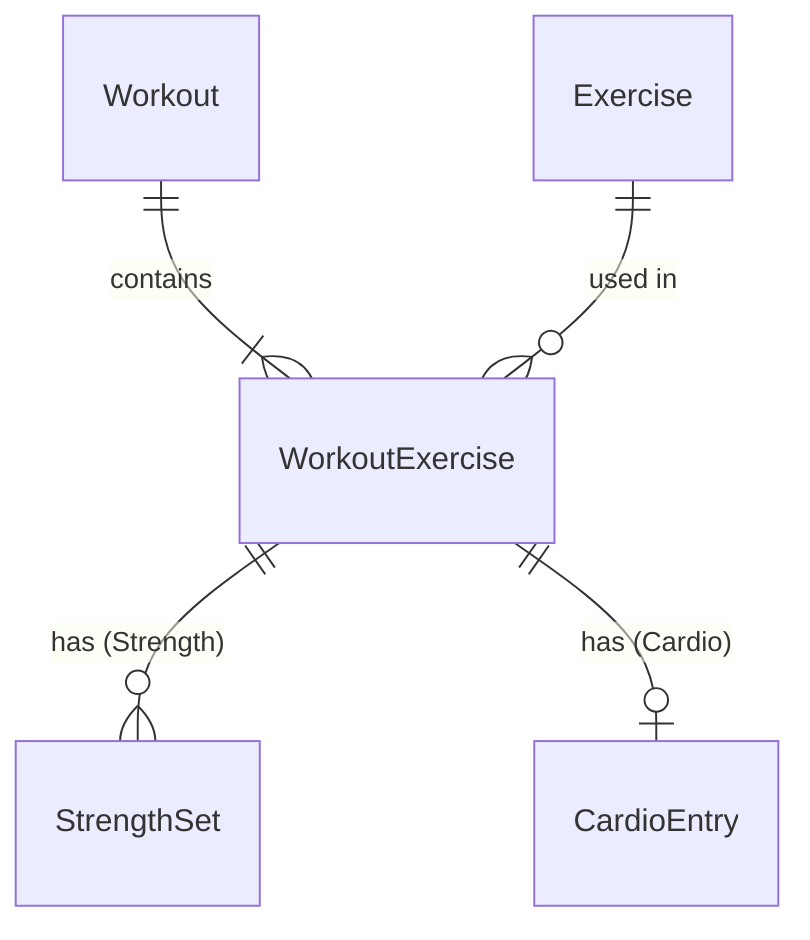

# 03 — Data Model

SQLite on the device, accessed with sqlite-net-pcl through `IWorkoutRepository`, `IExerciseSeeder` and `IDatabaseInitializer` (T22). Their calls run one at a time (T27).

## Approach: hybrid tables per exercise type
- Strength and cardio data live in **separate tables**: `StrengthSet` and `CardioEntry`.
- Each table has **one nullable column per metric**.
- Each exercise in the fixed list declares **which metrics it shows and which are required**. The UI and validation read this definition.
- Adding a new exercise is a list entry. Adding a new kind of metric is a new column.

## Metrics

| Metric | Type | Strength | Cardio | Notes |
|---|---|---|---|---|
| Reps | int | ✓ | | > 0 |
| WeightKg | decimal | ✓ | | ≥ 0, any decimal; the UI takes up to 2 places (D158). Per dumbbell. Assistance on assisted machines. |
| Duration | TimeSpan | ✓ | ✓ (always required) | > 0 when required, otherwise ≥ 0. Whole seconds (D169). Entered as h:mm:ss |
| Distance | decimal | ✓ (carries) | ✓ | > 0 when required (carries), otherwise ≥ 0. Unit from the exercise. The UI takes up to 2 places (D158) |
| Floors | int | | ✓ | ≥ 0 |
| Level | int | | ✓ | ≥ 0, whole number. Resistance, damper or speed level, per the exercise's label |
| Incline | decimal | | ✓ | ≥ 0, percent. The UI takes up to 2 places (D158) |
| Calories | int | | ✓ | ≥ 0, whole number |
| Rate | decimal | | ✓ | ≥ 0, unit from the exercise (e.g. steps/min). The UI takes up to 2 places (D158) |
| Pace | TimeSpan | | ✓ | ≥ 0, whole seconds, time per the exercise's pace unit (D168, D169). Entered as m:ss |

0 is a valid value for an optional metric (D127). Each metric has a maximum (D130, `MetricLimits`): reps 1,000; weight 1,000 kg; duration 23:59:59; distance 1,000 km or 100,000 m or ft; floors 1,000; level 100; incline 100 %; calories 10,000; pace 60:00 per km; rate 100 km/h, 300 rpm, 200 strokes/min, 300 strides/min, 300 steps/min, 1,000 ft/min.

sqlite-net stores `decimal` as REAL (floating point), `TimeSpan` as ticks and `DateTimeOffset` as UTC ticks.

## Exercise definition (Core project)
The definitions are an embedded JSON file in Core, from [exercises.json](../src/WorkoutLog.Core/Domain/Exercises/exercises.json). It is loaded once at startup into `IExerciseCatalog`, a singleton that every screen and service uses.

| Field | Type | Notes |
|---|---|---|
| Id | int | One sequence for all exercises. Never reused or changed. New exercises take the next number. |
| Name | string | Unique |
| Type | enum | `Strength` or `Cardio` |
| Aliases | list of string | Nicknames for search. Unique across the list. May be empty. |
| PrimaryMuscle | enum? | Strength only. Values in [04](04-exercise-list.md#fields-per-exercise) |
| Equipment | enum? | Strength only. Values in [04](04-exercise-list.md#fields-per-exercise) |
| Mechanic | enum? | `Compound` or `Isolation`. Strength only |
| Metrics | list of (Metric, Required, Label?) | Which metrics show, which are required, and an optional field label (e.g. `Assist`, `Resistance`, `Damper`) |
| DistanceUnit | enum? | `Km`, `Metres`, `Feet`. Null = no distance |
| RateUnit | enum? | `KmPerHour`, `Rpm`, `StrokesPerMin`, `StridesPerMin`, `StepsPerMin`, `FeetPerMin`. Null = no rate |
| PaceUnit | enum? | `PerKm`. Null = no pace (D168) |

The `Exercise` database table stores only Id, Name and Type, so other tables can reference it. All other fields come from the definition file, so changing them never needs a schema change.

## Exercise search
- At load, each exercise's name and aliases are split into words: lower case, apostrophes removed, and any other character that isn't a letter or digit as a space. These variants are replaced (D146, D155):

| Word | Becomes |
|---|---|
| triceps, biceps | tricep, bicep |
| flies, flyes, flye | fly |
| pullup(s), pushup(s), chinup(s), situp(s), stepup(s) | pull up, push up, chin up, sit up, step up |
| ups | up |
| nordics | nordic |
| skullcrusher | skull crusher |

- A partly typed two-word variant is split as the full one would be: pullu → pull u, skullc → skull c (D155).
- A query is split the same way, after cutting it to 50 characters; the search box also takes at most 50. An exercise matches when every query word starts a word of its name or aliases, in any order (D147, D155).
- Order: name starts with the query, then other name matches, then matches that need an alias; A–Z within each. "Starts with": each query word, in order, starts the name's word in the same place, so "dumb curl" ranks Dumbbell Curl first (D156).
- With no search text: every exercise, Strength then Cardio, A–Z.
- Search runs in memory on each keystroke. There is no search table in SQLite.

## Tables

### Exercise
| Field | Type |
|---|---|
| Id | int (from code) |
| Name | string |
| Type | int (enum) |

### Workout
| Field | Type | Notes |
|---|---|---|
| Id | int | Auto-increment |
| StartedAt | DateTimeOffset (UTC) | Set when New Workout opens. Never changes after save. Indexed (T61). |
| FinishedAt | DateTimeOffset (UTC) | Set on first save. Never changes after save. |

Date, day of week and total time are calculated from these and shown in the phone's current time zone. They are not stored.

### WorkoutExercise
| Field | Type | Notes |
|---|---|---|
| Id | int | Auto-increment |
| WorkoutId | int | → Workout, indexed |
| ExerciseId | int | → Exercise |
| Position | int | Order added, from 0 |

### StrengthSet
| Field | Type |
|---|---|
| Id | int |
| WorkoutExerciseId | int → WorkoutExercise, indexed |
| Position | int (order added, from 0) |
| Reps | int? |
| WeightKg | decimal? |
| Duration | TimeSpan? |
| Distance | decimal? |

### CardioEntry
| Field | Type |
|---|---|
| Id | int |
| WorkoutExerciseId | int → WorkoutExercise, **unique** (one entry per exercise) |
| Duration | TimeSpan (required) |
| Distance | decimal? |
| Floors | int? |
| Level | int? |
| Incline | decimal? |
| Calories | int? |
| Rate | decimal? |
| Pace | TimeSpan? |

## Diagram

## Rules
- A saved workout has at least one WorkoutExercise. Each one has at least one StrengthSet (strength) or exactly one CardioEntry (cardio).
- A set or entry is valid when it passes the checks in [Validation](#validation): required metrics filled, values within range, and no values for metrics the exercise doesn't declare. Every set and entry must be valid to save (FR-09).
- The exercise type decides which child table is used.
- Deleting a workout deletes its WorkoutExercises, sets and entries. sqlite-net creates no foreign keys or cascades, so the repository does these deletes in one transaction.
- Saving an edited workout replaces its WorkoutExercises, sets and entries in one transaction. The times are not changed (T23).
- Positions come from the order of the lists passed to the repository.
- The `→` references above are enforced in code, not by the database.
- Exercises are never deleted or hidden from the picker.

## Validation
`WorkoutValidator` checks a workout against each exercise's definition before `IWorkoutService` saves it (FR-09, T30). It returns codes; the UI words them.

| Level | Code | When | Message (UI) |
|---|---|---|---|
| Workout | `NoExercises` | No exercises | Add at least one exercise |
| Workout | `SaveFailed` | The database write failed (T32) | Couldn't save the workout. Try again. |
| Exercise | `UnknownExercise` | Id not in the list; its sets aren't checked | Exercise not found (on Save only, D170) |
| Exercise | `WrongType` | Strength for a cardio exercise or the other way round; its sets aren't checked | Exercise type doesn't match (on Save only, D170) |
| Exercise | `NoSets` | A strength exercise with no sets | Add at least one set |
| Set / entry | `Missing` | A required metric is empty | Enter {label} |
| Set / entry | `NotPositive` | Reps, a required duration or a required distance ≤ 0 | {Label} must be more than 0 |
| Set / entry | `Negative` | Any other metric < 0 (D126) | {Label} must be 0 or more |
| Set / entry | `NotWholeSeconds` | A duration or pace with part of a second (D169) | {Label} must be whole seconds |
| Set / entry | `TooLarge` | Above the metric's maximum (D130) | {Label} must be {max} or less |
| Set / entry | `NotShown` | A value for a metric the exercise doesn't show (D128) | None; logged (D170) |

At most one code per metric, in the order Missing, NotPositive or Negative, NotWholeSeconds, TooLarge (D169). Entry formats are checked by the UI before it builds the records (below). A null list, exercise, set or entry is a programming error and throws `ArgumentNullException` (T34). The service validates and saves its own copy of the list (T33).

### Entry formats (UI)
`ISetChecker` reads each field's text before Core checks the set or entry (T51). A field with a format message gets no message from Core. On Save, `IWorkoutChecker` checks every set and entry, then the workout through `IWorkoutService.Validate` (T54).

| Field | Accepted | Message (UI) |
|---|---|---|
| Number | Digits, optionally `.` and digits; `.5`; leading zeros. Not `5.`, spaces, `+`, `-`, `,` or exponents (D157, D161) | {Label} must be a number |
| Decimal | At most 2 decimal places, counting typed digits (`22.500` fails) (D158) | {Label} can have up to 2 decimal places |
| Whole number | No `.` (D159) | {Label} must be a whole number |
| Duration | Three boxes of digits; an empty box is 0, all empty is empty (D160) | {Label} must be a time |
| Duration | Minutes and seconds 00–59 (D160) | {Label} minutes and seconds must be 00–59 |
| Pace | Two boxes of digits, m:ss; an empty box is 0, all empty is empty (D167) | {Label} must be a time |
| Pace | Seconds 00–59; minutes any (D167) | {Label} seconds must be 00–59 |

A number too large for the set's types is capped (weight, distance, incline and rate at the largest decimal; reps, floors, level and calories at the largest int; duration just over 23:59:59 and pace just over 60:00), so Core reports `TooLarge`. The TooLarge message has no unit; a duration's maximum shows as 23:59:59 and a pace's as 60:00 (D163, D167). `NotShown` can't come from the UI and has no message; the set still fails and Warning 2502 is logged (D163, D164).

## Seeding the exercise list
- On startup, `IExerciseSeeder` inserts any exercise Id from the definition file that is missing from the database. It never removes rows.
- A changed name or type in a later app version updates the row by Id (D123).

## Schema upgrades
- The database stores its schema version in SQLite `user_version`. The app's version is `DatabaseInitializer.CurrentVersion`.
- Upgrade steps (`ISchemaUpgrade`) are numbered from 2; there is exactly one for each version up to the app's.
- On startup, `IDatabaseInitializer.InitializeAsync()` (T25, T28):
  1. Fails, changing nothing, if the stored version is newer than the app's, or the steps are not exactly one for each version from 2 to the app's.
  2. A new database (version 0): sqlite-net creates the tables, and the version is set to the app's. No steps run.
  3. An existing database: runs each step after the stored version, each in its own transaction with its version bump. Then sqlite-net creates any missing tables and columns.
  4. Seeds the exercise list (T21).
- A step sees the schema left by the previous step. Tables and columns sqlite-net adds from the row classes appear only after the last step.
- Any change sqlite-net can't make itself (rename, move or transform data) is a numbered upgrade step.

## Pace entry format
- Pace is entered and shown as `m:ss` (e.g. `5:30`), seconds 00–59, and stored as a TimeSpan (D168).
- Rate is entered and shown as a decimal.
