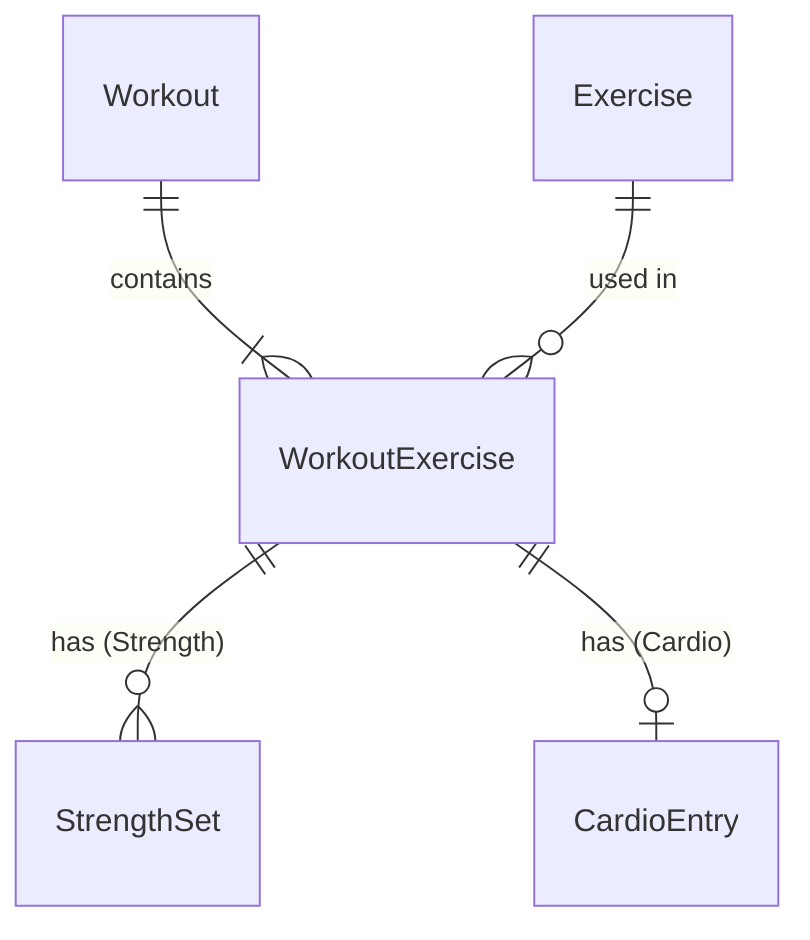

# 03 — Data Model

SQLite on the device, accessed with sqlite-net-pcl through `IWorkoutRepository`, `IExerciseSeeder` and `IDatabaseInitializer` (T22). Their calls run one at a time (T27).

## Approach: hybrid tables per exercise type
- Strength and cardio data live in **separate tables**: `StrengthSet` and `CardioEntry`.
- Each table has **one nullable column per metric**.
- Each exercise in the fixed list declares **which metrics it shows and which are required**. The UI and validation read this definition.
- Adding a new exercise is a list entry. Adding a new kind of metric is a new column.

## Metrics

| Metric | Type | Strength | Cardio | Notes |
|---|---|---|---|---|
| Reps | int | ✓ | | > 0 |
| WeightKg | decimal | ✓ | | ≥ 0, any decimal. Per dumbbell. Assistance on assisted machines. |
| Duration | TimeSpan | ✓ | ✓ (always required) | > 0, entered as h:mm:ss |
| Distance | decimal | ✓ (carries) | ✓ | ≥ 0, unit from the exercise |
| Floors | int | | ✓ | ≥ 0 |
| Level | int | | ✓ | ≥ 0, whole number. Resistance, damper or speed level, per the exercise's label |
| Incline | decimal | | ✓ | ≥ 0, percent |
| Calories | int | | ✓ | ≥ 0, whole number |
| Rate | decimal | | ✓ | ≥ 0, unit from the exercise (e.g. steps/min) |

No metric has a maximum value.

sqlite-net stores `decimal` as REAL (floating point), `TimeSpan` as ticks and `DateTimeOffset` as UTC ticks.

## Exercise definition (Core project)
The definitions are an embedded JSON file in Core, from [exercises.json](../src/WorkoutLog.Core/Domain/Exercises/exercises.json). It is loaded once at startup into `IExerciseCatalog`, a singleton that every screen and service uses.

| Field | Type | Notes |
|---|---|---|
| Id | int | One sequence for all exercises. Never reused or changed. New exercises take the next number. |
| Name | string | Unique |
| Type | enum | `Strength` or `Cardio` |
| Aliases | list of string | Nicknames for search. Unique across the list. May be empty. |
| PrimaryMuscle | enum? | Strength only. Values in [04](04-exercise-list.md#fields-per-exercise) |
| Equipment | enum? | Strength only. Values in [04](04-exercise-list.md#fields-per-exercise) |
| Mechanic | enum? | `Compound` or `Isolation`. Strength only |
| Metrics | list of (Metric, Required, Label?) | Which metrics show, which are required, and an optional field label (e.g. `Assist (kg)`, `Resistance`, `Damper`) |
| DistanceUnit | enum? | `Km`, `Metres`, `Feet`. Null = no distance |
| RateUnit | enum? | `KmPerHour`, `MinPerKm`, `Rpm`, `StrokesPerMin`, `StridesPerMin`, `StepsPerMin`, `FeetPerMin`. Null = no rate |

The `Exercise` database table stores only Id, Name and Type, so other tables can reference it. All other fields come from the definition file, so changing them never needs a schema change.

## Exercise search
- At load, each exercise gets a search string built from its name and aliases. It is lower-case, with hyphens as spaces and word variants normalised: triceps → tricep, biceps → bicep, flies/flyes → fly, pullup/pushup/chinup/situp/stepup → pull up, push up, etc.
- A query is normalised the same way. An exercise matches when every query word is found in its search string, in any order.
- Order: name starts with the query, then other name matches, then alias-only matches; A–Z within each.
- Search runs in memory on each keystroke. There is no search table in SQLite.

## Tables

### Exercise
| Field | Type |
|---|---|
| Id | int (from code) |
| Name | string |
| Type | int (enum) |

### Workout
| Field | Type | Notes |
|---|---|---|
| Id | int | Auto-increment |
| StartedAt | DateTimeOffset (UTC) | Set when New Workout opens. Never changes after save. |
| FinishedAt | DateTimeOffset (UTC) | Set on first save. Never changes after save. |

Date, day of week and total time are calculated from these and shown in the phone's current time zone. They are not stored.

### WorkoutExercise
| Field | Type | Notes |
|---|---|---|
| Id | int | Auto-increment |
| WorkoutId | int | → Workout, indexed |
| ExerciseId | int | → Exercise |
| Position | int | Order added, from 0 |

### StrengthSet
| Field | Type |
|---|---|
| Id | int |
| WorkoutExerciseId | int → WorkoutExercise, indexed |
| Position | int (order added, from 0) |
| Reps | int? |
| WeightKg | decimal? |
| Duration | TimeSpan? |
| Distance | decimal? |

### CardioEntry
| Field | Type |
|---|---|
| Id | int |
| WorkoutExerciseId | int → WorkoutExercise, **unique** (one entry per exercise) |
| Duration | TimeSpan (required) |
| Distance | decimal? |
| Floors | int? |
| Level | int? |
| Incline | decimal? |
| Calories | int? |
| Rate | decimal? |

## Diagram

## Rules
- A saved workout has at least one WorkoutExercise. Each one has at least one StrengthSet (strength) or exactly one CardioEntry (cardio).
- A set or entry is valid when every metric the exercise marks as required is filled. Metrics the exercise doesn't declare stay null. Every set and entry must be valid to save (FR-09).
- The exercise type decides which child table is used.
- Deleting a workout deletes its WorkoutExercises, sets and entries. sqlite-net creates no foreign keys or cascades, so the repository does these deletes in one transaction.
- Saving an edited workout replaces its WorkoutExercises, sets and entries in one transaction. The times are not changed (T23).
- Positions come from the order of the lists passed to the repository.
- The `→` references above are enforced in code, not by the database.
- Exercises are never deleted or hidden from the picker.

## Seeding the exercise list
- On startup, `IExerciseSeeder` inserts any exercise Id from the definition file that is missing from the database. It never removes rows.
- A changed name or type in a later app version updates the row by Id (D123).

## Schema upgrades
- The database stores its schema version in SQLite `user_version`. The app's version is `DatabaseInitializer.CurrentVersion`.
- Upgrade steps (`ISchemaUpgrade`) are numbered from 2; there is exactly one for each version up to the app's.
- On startup, `IDatabaseInitializer.InitializeAsync()` (T25, T28):
  1. Fails, changing nothing, if the stored version is newer than the app's, or the steps are not exactly one for each version from 2 to the app's.
  2. A new database (version 0): sqlite-net creates the tables, and the version is set to the app's. No steps run.
  3. An existing database: runs each step after the stored version, each in its own transaction with its version bump. Then sqlite-net creates any missing tables and columns.
  4. Seeds the exercise list (T21).
- A step sees the schema left by the previous step. Tables and columns sqlite-net adds from the row classes appear only after the last step.
- Any change sqlite-net can't make itself (rename, move or transform data) is a numbered upgrade step.

## Rate entry format
The entry format follows the rate unit:
- Pace (`MinPerKm`): entered and shown as `m:ss` (e.g. `5:30`), seconds 00–59. Stored as decimal minutes (`5.5`).
- All other rate units: entered and shown as a decimal.
