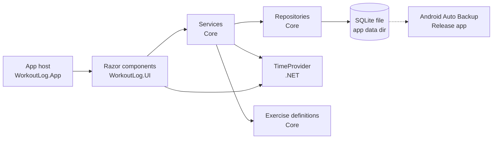

# 04 — Architecture

## Stack
| Area | Choice |
|---|---|
| Runtime | .NET 10 (LTS) |
| App | .NET MAUI Blazor Hybrid (Razor components in `BlazorWebView`) |
| Platform | Android only, minSdk = targetSdk = API 36 (Android 16) |
| Database | SQLite file in the app data folder; the Release app's is backed up by Android Auto Backup (D05) |
| State | Blazor components + injected services. No MVVM toolkit. |
| Tests | Unit, component and E2E ([05](05-testing.md)) |

## Layers

References: App → UI → Core. UI.Stories → UI. UI.Tests → UI, UI.Stories (sample data and the stories' own components). E2E.Tests → Core (to seed workouts, D145). The App never references UI.Stories.

- **App** hosts the BlazorWebView, registers DI and the logging providers, and handles the Android back button.
- **UI** renders and calls services only. It never touches the database. Form fields come from the exercise's metric definition.
- **Services** hold the rules: save validation, start/finish capture, dashboard counts.
- **Repositories** handle database access, behind interfaces so services can be unit-tested with mocks.
- **TimeProvider** (.NET) supplies the current time to services and the UI's live timer, so tests can fake the clock (D114, D117).
- **Exercise definitions** are an embedded JSON file in Core, read into the `IExerciseCatalog` singleton by the seeder at startup (D109). The catalog also runs the picker search in memory ([02](02-data-model.md#exercise-search)).

## Dependency injection
- Everything is registered in `MauiProgram.CreateMauiApp()`. Core registers its types through `AddCore(databasePath)` (D105) and UI through `AddUi()` (D123); services and repositories are registered by interface.
- Core's public services are `IWorkoutService`, `IHistoryService`, `IDashboardService` and `IWeightHistoryService`; the repository and validator are internal (D107, D116, D48).
- `AddCore` creates one database connection and gives it only to the initializer, the exercise seeder and the repository. The initializer and repository are decorators that run each call through one `DatabaseGate`, so database calls run one at a time; nothing can resolve a database type that skips the gate (D106, D105).
- At startup `StartupGate` awaits `IDatabaseInitializer.InitializeAsync()`, which upgrades and creates the schema and seeds the exercise list, and shows the Startup screen until it completes, or its error if it throws (D108, D75).
- `AddUi` registers `IBackButton`, `ISetChecker`, `IWorkoutChecker` and one `AppLifecycle` as `IAppStart` and `IAppLifecycle` (D125, D119), and `WorkoutEditor` as transient. `NewWorkoutPage` and `EditWorkoutPage` each inject their own `WorkoutEditor`, which holds the exercises, the picker, changes, and the check and save (D117). The App adds `AndroidBackButton` ([Navigation](#navigation)) and the logging providers ([Logging](#logging)).
- The stories app registers `SampleWorkoutService` in place of Core's workout service (D120).

## Navigation
Blazor routing (`@page`):
| Route | Screen |
|---|---|
| `/` | Dashboard |
| `/workout/new` | New workout (D117) |
| `/workout/{id}` | Edit workout (D117) |
| `/history` | History |

The Exercise picker is an overlay on the workout page, not a route. What Android back does on each screen is on the [Navigation](../src/WorkoutLog.UI.Stories/Stories/Foundations/Navigation.md) page and the [screen pages](../src/WorkoutLog.UI.Stories/Stories/Screens/).

How back works (D119):
- `BackHandler` (UI) registers a handler with `IBackButton` while its `OnBack` is set. `AppScreen` uses it for `OnBack`, `ExercisePicker` for `OnClose` and `ConfirmDialog` for `OnCancel`, so Android back does what the on-screen back or Cancel does (D78). The newest registration runs, so the picker or a dialog takes back over its page.
- A handler that throws shows the Error screen, as a click would (D76).
- `AndroidBackButton` (App) adds an AndroidX `OnBackPressedCallback` when the activity is created; Android 16 calls no other back callback. It is on only while a handler is registered, so Android knows before the gesture starts whether the app takes back. Handlers belong to the current activity: a new activity drops earlier ones, and destroying the current activity clears them all; the destroy of an earlier activity is ignored (D119).
- With no handler (the Dashboard), the callback is off and the app closes (D78).
- The BlazorWebView takes back while the WebView can go back in its history, so the App navigates with `GoTo` (`replace: true`), has no links, and never builds a history.

## Dashboard
- `DashboardPage` (UI) loads through `IDashboardService.GetAsync()` each time it's shown, and again when the activity starts while it's shown. A load while one runs is ignored (D67, D118).
- `DashboardService` reads the latest start and the starts from the earlier of the week and month start to now, then counts them. The week starts Monday 00:00 and the month the 1st at 00:00 in `TimeProvider.LocalTimeZone` (D66, D116).
- `AppLifecycle` (UI) holds the app start handlers that pages register through `IAppStart`. The App calls `IAppLifecycle` from the activity lifecycle, with the same per-activity rule as the back button (D119).

## Start / finish capture
- `NewWorkoutPage` (UI) asks `IWorkoutService.StartNew()` for a `WorkoutDraft`. The service stamps `StartedAt` (UTC) from `TimeProvider` (D112) and logs the start.
- The page shows the date in `TimeProvider.LocalTimeZone` and an elapsed timer that ticks every second. While the clock is before `StartedAt` it shows 0:00:00 (D117, D26).
- The draft stays in memory only (FR-12: lost if the app is killed). Android may kill the app while the phone is locked; this is accepted (D45).
- On the first save, the service validates (FR-09), stamps `FinishedAt` and writes everything in one transaction. If the clock is earlier than `StartedAt`, `FinishedAt` is set to `StartedAt` (D26).
- Later saves update the exercises, sets and entries only. They never change the times.

## Error handling
What each error shows is on the [screen pages](../src/WorkoutLog.UI.Stories/Stories/Screens/).
- Validation failures are shown inline. Nothing is written. The service returns error codes; the page words them (D113).
- Services turn any repository exception into a failed result and log it: `HistoryResult.Failed` (D116), `DashboardResult.Failed`, the week and month maths included (D67, D116), `WorkoutLoad.Failed` (D72, D112), `WorkoutError.SaveFailed` (D115), `WorkoutDelete.Failed`, a missing workout included (D46, D112), and `WeightHistoryResult.Failed` (D48).
- An unhandled error in a screen shows the Error screen. `AppErrorBoundary` in the App's `Routes` shows it and logs the error (D76).
- Unhandled .NET exceptions are logged, then the app crashes. Unobserved task exceptions are logged only (D133).

## Logging
**How**
- Core and UI inject `ILogger<T>` and never know where logs go. Each host registers its own `ILoggerProvider`s and levels in its startup (D130).
- Each logging type has a nested `static partial class Log` of `[LoggerMessage]` methods, each with a fixed EventId and level (D132). Each project names its EventIds in an internal enum, used as `(int)UiEvent.X` (D132): `CoreEvent` 1000–1999 and `UiEvent` 2000–4999, a block of 100 per type; `AppEvent` 5000+, a block of 10 per group. In a Razor component the `Log` class goes in `<Component>.razor.cs`.
- Tests check each event's EventId, level, message and exception ([05](05-testing.md)).

**What to log**
| Level | When |
|---|---|
| Critical | The app is about to crash |
| Error | An operation failed: an exception caught and turned into an error code or error screen. Pass the exception |
| Warning | Something unexpected that the app works around (e.g. the clock before the start, D26) |
| Information | A milestone: startup steps, a workout saved or deleted, lifecycle events |
| Debug | Detail for a debugging session |

**Never log** set values, entry values or notes, and never put them in an exception message. Ids, counts, versions, durations and exception details only. Validation errors (FR-09) are not logged (D135). So that exception messages stay clean:
- Parse user input with `TryParse`, never `Parse`: a failed `Parse` puts the input in its `FormatException` message.
- Never put a domain record (set, entry, workout) in a message: its `ToString()` prints every value.

**Android App**
| Provider | Where | Read with |
|---|---|---|
| `AndroidLogProvider` (App) | logcat, tag `WorkoutLog` | `adb logcat -s WorkoutLog` ([06](06-dev-setup-build.md#reading-the-logs)) |
| `FileLogProvider` (Core) | `logs/workoutlog.log` in the app-specific external files folder, or the app data folder if there is none; becomes `workoutlog.1.log` at 1 MB (D131) | `adb pull` ([06](06-dev-setup-build.md#reading-the-logs)) |

- Levels: Debug builds from Debug, Release from Information, `Microsoft.*` from Warning (D134).
- `AndroidDiagnostics` logs the start (version, version code, build, API level), the previous exit reason, activity created/started/stopped/destroyed and trim-memory requests. On start `MauiProgram` subscribes to unhandled and unobserved-task exceptions (D133).
- On API 36 Android never calls `OnLowMemory`, and trim memory only reports `UiHidden` or `Background`, so it is logged at Information. Memory kills and WebView render process ends show as the previous exit reason on the next start (D133).

## Android 16 platform notes
- **Edge-to-edge:** the app draws under the status and navigation bars, with no opt-out on API 36. The layout must keep content inside the safe-area insets.
