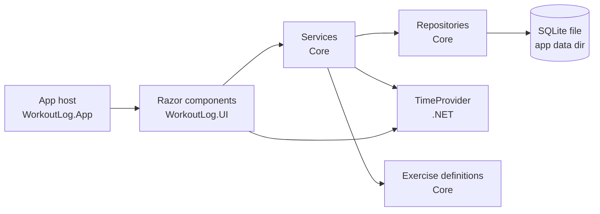

# 05 — Architecture

## Stack
| Area | Choice |
|---|---|
| Runtime | .NET 10 (LTS) |
| App | .NET MAUI Blazor Hybrid (Razor components in `BlazorWebView`) |
| Platform | Android only, minSdk = targetSdk = API 36 (Android 16) |
| Database | SQLite via sqlite-net-pcl |
| State | Blazor components + injected services. No MVVM toolkit. |
| Tests | NUnit, Moq, AutoFixture, bUnit, Appium (see [07](07-testing.md)) |

## App identity
| Item | Value |
|---|---|
| Display name | Workout Log (Debug builds: Workout Log (Dev)) |
| Android package id | `uk.martinshields.workoutlog` (Debug builds: `uk.martinshields.workoutlog.debug`) |

## Solution layout
```
WorkoutLog.slnx
├─ src/
│  ├─ WorkoutLog.App/          MAUI Blazor Hybrid host (net10.0-android)
│  │   ├─ wwwroot/             index.html
│  │   └─ MauiProgram.cs       DI registration
│  ├─ WorkoutLog.UI/           Razor Class Library (net10.0): pages and components
│  │   └─ wwwroot/css/         Design tokens and shared CSS ([12](12-design-system.md))
│  ├─ WorkoutLog.UI.Stories/   BlazingStory WebAssembly app (net10.0): stories for UI components
│  └─ WorkoutLog.Core/         Class library (net10.0)
│      ├─ Domain/              Records/entities, metrics, exercise definitions, validation
│      ├─ Data/                sqlite-net repositories, schema, seeding
│      ├─ Logging/             File log provider, shared log line format
│      └─ Services/            Workout, history, dashboard services
└─ tests/
   ├─ WorkoutLog.Core.Tests/       NUnit + Moq + AutoFixture
   ├─ WorkoutLog.UI.Tests/         bUnit
   └─ WorkoutLog.E2E.Tests/        Reqnroll + NUnit + Appium
```
References: App → UI → Core. UI.Stories → UI. UI.Tests → UI, UI.Stories (to play the prototype scenarios). E2E.Tests → Core (to seed workouts, T81). The App never references UI.Stories.

## Layers

- **App** hosts the BlazorWebView, registers DI and the logging providers, and handles the Android back button.
- **UI** renders and calls services only. It never touches the database. Form fields come from the exercise's metric definition.
- **Services** hold the rules: save validation, start/finish capture, dashboard counts.
- **Repositories** handle sqlite-net access. They sit behind interfaces so services can be unit-tested with Moq.
- **TimeProvider** (.NET) supplies the current time, so start/finish, the live timer and week/month counts can be tested with `FakeTimeProvider` (T31). The UI uses it for the live timer (T47).
- **Exercise definitions** are an embedded JSON file in Core, read into the `IExerciseCatalog` singleton on first use: the seeder, at startup (T45). The catalog also runs the picker search in memory (see [03](03-data-model.md#exercise-search), [04](04-exercise-list.md)).

## Dependency injection
Everything is registered in `MauiProgram.CreateMauiApp()` using the built-in `IServiceCollection`. Core registers its own types through `AddCore(databasePath)` (T19); the App passes `workoutlog.db3` in `FileSystem.AppDataDirectory`. Of the services, only `IWorkoutService`, `IHistoryService` and `IDashboardService` are public; the repository and validator are internal (T33, T60, T70). The database connection is an `SQLiteAsyncConnection` singleton. Services and repositories are registered by interface. At startup the App's `Routes` component wraps the router in `StartupGate`, which awaits `IDatabaseInitializer.InitializeAsync()` and shows the Startup screen until it completes, or its error if it throws (T36, D133). The initializer upgrades and creates the schema, then seeds the exercise list (T25, T28). The initializer and repository are decorators that run each call through one `DatabaseGate`, so database calls run one at a time (T27). Logging providers are registered in `MauiProgram` too ([Logging](#logging)). UI registers its own types through `AddUi()` (T51): the `IBackButton`, `ISetChecker` and `IWorkoutChecker` singletons, and one `AppLifecycle` as `IAppStart` and `IAppLifecycle` (T54, T72); the App and the stories app call it. The App also registers `AndroidBackButton` ([Navigation](#navigation)) and runs `IAppLifecycle` from the activity lifecycle ([Dashboard](#dashboard)). UI page components such as `NewWorkoutPage` inject `IWorkoutService`, `IExerciseCatalog`, `TimeProvider`, `ISetChecker` and `IWorkoutChecker`; `EditWorkoutPage` injects the same (T65); `HistoryPage` injects `IHistoryService` and `TimeProvider` (T62); `DashboardPage` injects `IDashboardService`, `TimeProvider` and `IAppStart` (T71); the stories app registers `TimeProvider.System`, `SampleWorkoutService`, `SampleDashboardService` and `ExerciseCatalog` for them (T48, T50, T52, D198).

## Navigation
Blazor routing (`@page`):
| Route | Screen |
|---|---|
| `/` | Dashboard |
| `/workout/new` | New workout (T47) |
| `/workout/{id}` | Edit workout (T65) |
| `/history` | History |

The Exercise picker is an overlay on the workout page, not a route.

The Android back button is passed to the current page:
- Workout pages: close the picker if it's open; otherwise show the Discard / Cancel prompt (FR-12, FR-23). New Workout ignores back while a save runs and after one succeeds (D179). Edit Workout asks only after a change, otherwise goes to History, and ignores back while a save runs and after one succeeds (D189), and while a delete runs and after one succeeds (D191); while loading, after a failed load or when it isn't found, back goes to History (D185).
- History: go to the Dashboard.
- Dashboard: leave the app.

How (T46):
- `BackHandler` (UI) registers a handler with `IBackButton` while its `OnBack` is set. `AppScreen` uses it for `OnBack`, `ExercisePicker` for `OnClose` and `ConfirmDialog` for `OnCancel`, so Android back does what the on-screen back or Cancel does (D144). The newest registration runs, so the picker or a dialog takes back over its page.
- A handler that throws shows the Error screen, as a click would (D140).
- `AndroidBackButton` (App) adds an AndroidX `OnBackPressedCallback` when the activity is created. It is on only while a handler is registered, so Android knows before the gesture starts whether the app takes back. Handlers belong to the current activity: a new activity drops earlier ones when it is created, and destroying the current activity clears every handler, as the pages in it are not disposed. The destroy of an earlier activity is ignored (T74).
- With no handler (the Dashboard has no `OnBack`), the callback is off and the default runs: the app closes and the activity is destroyed (D143).
- The BlazorWebView takes back while the WebView can go back in its history, so the App navigates with `GoTo` (`replace: true`), has no links, and never builds a history.

## Dashboard
- `DashboardPage` (UI) loads through `IDashboardService.GetAsync()` each time it's shown, and again when the activity starts while it's shown. A load while one runs is ignored (D197, T71).
- `DashboardService` reads the latest start with `IWorkoutRepository.ListAsync(limit: 1)` and the starts from the earlier of the week and month start to now with `ListAsync(from, to)`, then counts them. The week starts Monday 00:00 and the month the 1st at 00:00 in `TimeProvider.LocalTimeZone` (D196, T70).
- `AppLifecycle` (UI) holds the app start handlers that pages register through `IAppStart`. The App's `MauiProgram` calls `IAppLifecycle.Attach` when an activity is created, `NotifyStartedAsync()` when it starts and `Detach` when it is destroyed, with the same per-activity rule as the back button (T72, T74).

## Start / finish capture
- `NewWorkoutPage` (UI) asks `IWorkoutService.StartNew()` for a `WorkoutDraft`. The service stamps `StartedAt` (UTC) from `TimeProvider` (T29) and logs the start.
- The page shows the date in `TimeProvider.LocalTimeZone` and an elapsed timer that ticks every second from `TimeProvider`. While the clock is before `StartedAt` it shows 0:00:00 (T47, D145).
- The draft stays in memory only (FR-12: lost if the app is killed). Android may kill the app while the phone is locked; this is accepted (D61).
- On the first save, the service validates (FR-09), stamps `FinishedAt` and writes everything in one transaction. If the clock is earlier than `StartedAt`, `FinishedAt` is set to `StartedAt` (D129).
- Later saves update the exercises, sets and entries only. They never change the times.

## Error handling
- Validation failures are shown inline on the page. Nothing is written. The service returns error codes; the page words them (T30).
- History load errors show "Couldn't load your history." with **Try again**. `IHistoryService` turns any repository exception into `HistoryResult.Failed` and logs it (T60).
- Dashboard load errors show "Couldn't load the Dashboard." with **Try again** in place of the summary; History and New Workout still work. `IDashboardService` turns any exception, from the repository or the week and month maths, into `DashboardResult.Failed` and logs it (D195, T70).
- Opening a workout that fails to load shows "Couldn't load the workout." with **Try again**; a missing one shows "This workout no longer exists." `IWorkoutService.GetAsync` turns any repository exception into `WorkoutLoad.Failed` and logs it (D185, T63).
- Database errors are shown as a simple error message ("Couldn't save the workout. Try again."). The service turns any repository exception into `WorkoutError.SaveFailed` (T32) and logs it. The draft stays on screen.
- A failed delete shows "Couldn't delete the workout. Try again."; the workout stays on screen. `IWorkoutService.DeleteAsync` turns any repository exception, a missing workout included, into `WorkoutDelete.Failed` and logs it (D191, T68).
- An unhandled error in a screen shows the Error screen: "Something went wrong." and **Restart**, which goes to the Dashboard. `AppErrorBoundary` in the App's `Routes` shows it and logs the error (D140).
- Unhandled .NET exceptions are logged, then the app crashes. Unobserved task exceptions are logged only (T44).

## Logging
Every story logs its errors and unexpected events (D141). The Definition of Done checks this ([11](11-product-goal.md)).

**How**
- Core and UI inject `ILogger<T>` and never know where logs go. Each host registers its own `ILoggerProvider`s and levels in its startup (T41).
- Each logging type has a nested `static partial class Log` of `[LoggerMessage]` methods, each with a fixed EventId and level (T43). Each project names its EventIds in an internal enum, used as `(int)UiEvent.X` (T66): `CoreEvent` 1000–1999 and `UiEvent` 2000–4999, a block of 100 per type; `AppEvent` 5000+, a block of 10 per group. In a Razor component the `Log` class goes in `<Component>.razor.cs`.
- Tests check each event with `FakeLogger` (Microsoft.Extensions.Diagnostics.Testing): EventId, level, message and exception ([07](07-testing.md)).

**What to log**
| Level | When |
|---|---|
| Critical | The app is about to crash |
| Error | An operation failed: an exception caught and turned into an error code or error screen. Pass the exception |
| Warning | Something unexpected that the app works around (e.g. the clock before the start, D129) |
| Information | A milestone: startup steps, a workout saved or deleted, lifecycle events |
| Debug | Detail for a debugging session |

**Never log** set values, entry values or notes, and never put them in an exception message. Ids, counts, versions, durations and exception details only. Validation errors (FR-09) are not logged (D142). So that exception messages stay clean:
- Parse user input with `TryParse`, never `Parse`: a failed `Parse` puts the input in its `FormatException` message.
- Never put a domain record (set, entry, workout) in a message: its `ToString()` prints every value.

**Android App**
| Provider | Where | Read with |
|---|---|---|
| `AndroidLogProvider` (App) | logcat, tag `WorkoutLog` | `adb logcat -s WorkoutLog` ([08](08-dev-setup-build.md#reading-the-logs)) |
| `FileLogProvider` (Core) | `logs/workoutlog.log` in the app-specific external files folder, or the app data folder if there is none; becomes `workoutlog.1.log` at 1 MB (T42) | `adb pull` ([08](08-dev-setup-build.md#reading-the-logs)) |

- Levels: Debug builds from Debug, Release from Information, `Microsoft.*` from Warning (D139).
- `AndroidDiagnostics` logs the start (version, version code, build, API level), the previous exit reason, activity created/started/stopped/destroyed and trim-memory requests. `MauiProgram` registers its handlers with `ConfigureLifecycleEvents`; on start it subscribes to unhandled and unobserved-task exceptions (T44).
- On API 36 Android never calls `OnLowMemory`, and trim memory only reports `UiHidden` or `Background`, so it is logged at Information. Memory kills show as the previous exit reason (`LowMemory`) on the next start (T44).
- The WebView render process ending can't be logged; the next start logs the exit reason (T44).
- The log file shows when each workout was saved (ids and counts only). adb or a USB-connected PC can read it on both builds (T42).

## Dependencies
Confirmed in US-02 (D75), updated by D218. This is the list of approved packages. Their versions live in the project files, `package.json` and the workflows; Dependabot proposes updates as PRs, and merging one approves it (D218).

| Package | Project | Purpose |
|---|---|---|
| sqlite-net-pcl | Core | ORM. Brings in SQLitePCLRaw and the native SQLite library (SourceGear.sqlite3) |
| Microsoft.Extensions.DependencyInjection.Abstractions | Core | `IServiceCollection` for `AddCore` (T19) |
| Microsoft.Extensions.Logging.Abstractions | Core | `ILogger<T>` and `[LoggerMessage]` (T41, T43) |
| NUnit | tests | Test framework |
| NUnit3TestAdapter | tests | Test adapter |
| NUnit.Analyzers | tests | Build-time NUnit checks |
| Microsoft.NET.Test.Sdk | tests | Test host |
| Moq | tests | Mocks |
| AutoFixture, AutoFixture.AutoMoq | tests | Test data |
| Microsoft.Extensions.TimeProvider.Testing | Core.Tests, UI.Tests | `FakeTimeProvider` (T31) |
| Microsoft.Extensions.Diagnostics.Testing | Core.Tests, UI.Tests | `FakeLogger` (T43) |
| bunit | UI.Tests | Component tests |
| Appium.WebDriver | E2E.Tests | UI automation (Selenium). Checked against the Appium version in `package.json` (T76) |
| Reqnroll.NUnit | E2E.Tests | Runs the Gherkin features on NUnit (T80). Brings in Reqnroll, Gherkin and the Cucumber packages |
| Microsoft.Extensions.DependencyInjection | E2E.Tests | Builds Core's services to seed workouts (T81) |
| BlazingStory | UI.Stories | Component stories and prototyping (D99). Prerelease only; no stable version exists |
| MD2RazorGenerator | UI.Stories | Build-time only. Turns the design-system Markdown pages into BlazingStory pages (D100) |

npm devDependencies in `tests/WorkoutLog.E2E.Tests/package.json`, approved in US-23: exact versions, installed with `npm ci --ignore-scripts` from the committed `package-lock.json` (T76). Its `overrides` lift vulnerable packages that appium pins; packages bundled inside the driver can't be overridden (T93, [US-38](https://github.com/marty-shields/workout-log-app/issues/47)):

| Package | Purpose |
|---|---|
| appium | Appium server, started by the E2E tests |
| appium-uiautomator2-driver | Android driver. Downloads Chromedriver for the device's WebView |

GitHub Actions in `.github/workflows/`, pinned by commit SHA (T91):

| Action | Purpose |
|---|---|
| actions/checkout | Checks out the repo |
| actions/setup-dotnet | Installs the .NET 10 SDK |

MAUI packages (`Microsoft.Maui.Controls`, `Microsoft.AspNetCore.Components.WebView.Maui`) come from the template, pinned with `MauiVersion` in the App project (T38).

Blazor packages (`Microsoft.AspNetCore.Components.Web` in UI; `Microsoft.AspNetCore.Components.WebAssembly` and `.DevServer` in UI.Stories) come from the project templates.

`ILogger<T>` reaches UI through `Microsoft.AspNetCore.Components.Web`, and the App gets Microsoft.Extensions.Logging through MAUI. No logging provider packages are used (T38, T41).

Checks:
- `SQLitePCLRaw.bundle_green` is not used. It is on the 2.x line and conflicts with the 3.x packages sqlite-net-pcl brings in.
- 16 KB memory pages: the Android native libraries in SourceGear.sqlite3 (arm, arm64, x64, x86) are 16 KB aligned. Recheck on each SourceGear.sqlite3 update.

## Android 16 platform notes
- **Edge-to-edge:** the app draws under the status and navigation bars, with no opt-out on API 36. The layout must keep content inside the safe-area insets.
- **Predictive back:** the old back-press callbacks aren't called on API 36. Back goes through an AndroidX `OnBackPressedCallback` instead ([Navigation](#navigation), [US-28](https://github.com/marty-shields/workout-log-app/issues/37)).
