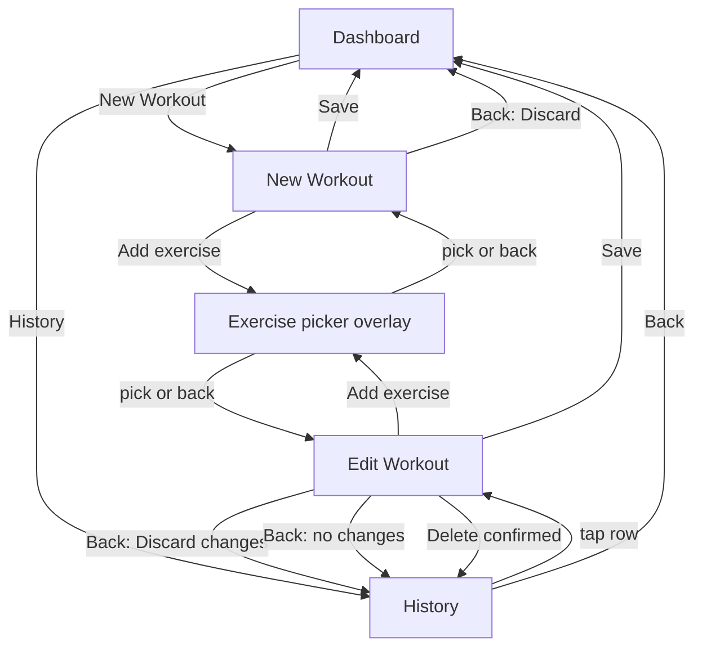

# 06 — Screens & UX

## Screens

### Dashboard (home)
- **New Workout** button
- Last workout: date + day, or an empty state
- Workouts this week (Monday start)
- Workouts this month
- **History** link

### New / Edit Workout
- Header: date + day (from the start time)
  - New: live elapsed timer (h:mm:ss)
  - Edit: total time (h:mm:ss)
- List of added exercises, in the order added. Each one shows the fields its definition declares ([04](04-exercise-list.md)):
  - Strength: rows of sets (e.g. reps + weight, duration for Plank, distance for carries), **Add set**, remove set. Starts with one empty set.
  - Cardio: one entry (duration + the exercise's other metrics, with units). Starts empty; not removable on its own.
  - Fields use the exercise's label where it has one (e.g. Assist (kg), Resistance, Damper).
  - Remove exercise
- **Add exercise** opens the Exercise picker
- **Save** button: validates (FR-09) and returns to the Dashboard. Errors show on the exercise or set at fault.
- Edit only: **Delete** (confirm dialog)
- Back:
  - New workout: **Discard / Cancel**
  - Edit with unsaved changes: **Discard changes / Cancel**
  - Edit with no unsaved changes: History, no prompt

### Exercise picker
- An overlay on the workout page. Back closes it.
- Search box at the top. It matches names and nicknames, every word in any order ([03](03-data-model.md#exercise-search)).
- With no search text: the full list A–Z, grouped Strength / Cardio
- Tap to add to the workout
- Exercises already in the workout are still shown (FR-04)

### History
- Saved workouts, newest first
- Row: date, day of week and start time (e.g. *Tue 21 Oct 2026 · 18:05*)
- Tap opens the workout in edit mode
- Empty state: "No workouts yet"
- Back: Dashboard

Back on the Dashboard leaves the app.

## Navigation

## Design system & prototyping
Done in M1.5, before the screens are built in M2 (D96). Details: [14 Design system](14-design-system.md).
- Wireframes and designs are stories in `WorkoutLog.UI.Stories` (BlazingStory, D99).
- Light and dark themes; the app follows the phone's setting (D97).
- Numbers use the phone's numeric keyboard. Duration is three boxes: h, mm, ss (D98).
- Layout suits one-handed use in the gym.
- Content stays inside the Android 16 safe-area insets (see [05](05-architecture.md#android-16-platform-notes)).
