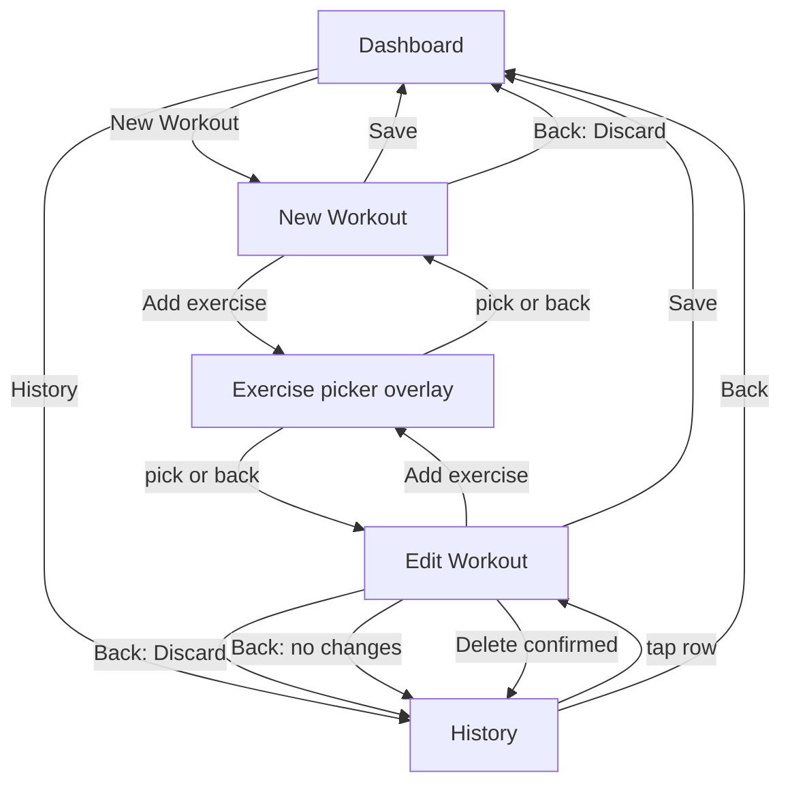

# 06 — Screens & UX

## Screens

### Startup
- Shown while the database opens, before the Dashboard (T36)
- Spinner with "Loading…" (D134), or "Couldn't open the workout database." if it fails (D133)

### Error
- Shown instead of any screen that hits an unhandled error (D140)
- "Something went wrong." and **Restart**, which goes to the Dashboard. An unsaved workout is lost.

### Dashboard (home)
- **New Workout** button
- Last workout: date + day of the latest start, or an empty state (FR-32)
- Workouts this week: from Monday 00:00 to now (FR-33, D196)
- Workouts this month: from the 1st at 00:00 to now (FR-34, D196)
- A workout dated after now shows as the last workout but isn't counted (D196)
- **History** link
- Loads each time it's shown and when the app comes back; a load shows the spinner (D197)
- While loading: spinner "Loading…" in place of the last workout and counts (D195)
- Load failed: "Couldn't load the Dashboard." and **Try again**, which reloads, in place of the last workout and counts. Focus moves to Try again (D195)
- History and New Workout work while loading and after a failed load (D195)

### New / Edit Workout
- Header: date + day (from the start time)
  - New: live elapsed timer (h:mm:ss)
  - Edit: total time (h:mm:ss)
- List of added exercises, in the order added. Each one shows the fields its definition declares ([04](04-exercise-list.md)):
  - Strength: rows of sets (e.g. reps + weight, duration for Plank, distance for carries), **Add set**, remove set. Starts with one empty set. Add set does nothing while the last set (or the open set, below) is empty or has errors; the errors show on that set and focus moves to its first field at fault (D106, D162). Format errors and Core's rules are in [03](03-data-model.md#entry-formats-ui).
    - Exercises with more than two fields, one of them a duration (carries): one set is open, with every field labelled; the others show as a summary line (e.g. *40 m · 32 kg · 0:00:45*). Tap a summary to open it, once the open set is valid; Add set opens the new set. A new workout opens the last set; an edited workout starts with all sets closed. Errors on a closed set show under its summary, which gets a red outline (D105, D118).
  - Cardio: one entry (duration + the exercise's other metrics, with units). Starts empty; not removable on its own.
  - Fields use the exercise's label where it has one (e.g. Assist (kg), Resistance, Damper).
  - A partly filled duration or pace fills in when focus leaves it: empty boxes become 0, minutes and seconds two digits (e.g. *1:00:00*, *0:00:22*, *5:03*) (D107).
  - Remove exercise: removes it at once, with no confirm (D150)
- **Add exercise** opens the Exercise picker. After a pick, focus moves to the new exercise's first field, which scrolls it into view (D151).
- **Save** button: validates (FR-09), saves and returns to the Dashboard. If the save fails, "Couldn't save the workout. Try again." shows at the top, the workout stays and focus moves to Save (D176). Taps while a save runs are ignored (D177); on Edit, also while a delete runs and after one succeeds (D191). Errors show on the exercise, set or entry at fault: each faulty field is outlined, with one message per problem under its set or entry (D103). Focus moves to the first error: Add exercise, an exercise's Add set or Remove, the first field at fault, or a closed set's summary line (D171). Once a set or entry fails a check, every change re-checks it until it passes Add set or opening another set, or the whole workout passes Save (D108, D174); adding a set clears "Add at least one set" and adding an exercise clears the workout error (D108). Cardio entries are first checked on Save (D166).
- Edit only: **Delete** asks "Delete this workout?" **Delete / Cancel**, the same with or without unsaved edits. Delete removes the workout and goes to History (FR-24). If it fails, "Couldn't delete the workout. Try again." shows at the top, the workout and its edits stay and focus moves to Delete. Ignored while a save or delete runs, after one succeeds and after a discard; while a delete runs and after it succeeds, Cancel and Android back leave the prompt open (D191).
- Edit only, until the workout loads, under the title "Workout" (D185):
  - Loading: spinner "Loading…"
  - Load failed: "Couldn't load the workout." and **Try again**, which reloads. Focus moves to Try again. An exercise missing from the list, or saved as the wrong kind, also shows this.
  - Not found: "This workout no longer exists.", no Try again
- Back:
  - New workout: **Discard / Cancel**, even with no exercises; ignored while a save runs and after one succeeds (D179)
  - Edit with unsaved changes: **Discard changes? Discard / Cancel**; Discard goes to History. A change is a value typed, a set added or removed, or an exercise added or removed, even if later undone (D189)
  - Edit with no unsaved changes: History, no prompt
  - Edit: ignored while a save runs and after one succeeds (D189), and while a delete runs and after one succeeds (D191)
  - Edit while loading, after a failed load or when not found: History (D185)

### Exercise picker
- An overlay on the workout page. Back closes it.
- Search box at the top, empty each time the picker opens (D152). It matches names and nicknames, every word in any order ([03](03-data-model.md#exercise-search)).
- With no search text: the full list A–Z, grouped Strength / Cardio
- Tap to add to the workout; the picker closes
- Exercises already in the workout are still shown. Picking one goes to its card instead of adding it again: strength adds a set, cardio focuses its entry (FR-04, D154)

### History
- Saved workouts, newest first by start time; same start, newest saved first (D182). All load at once (D183)
- Row: date, day of week and start time (e.g. *Tue 21 Oct 2026 · 18:05*)
- Tap opens the workout in edit mode (D186)
- Empty state: "No workouts yet"
- While loading: spinner "Loading…" (D181)
- Load failed: "Couldn't load your history." and **Try again**, which reloads. Focus moves to Try again (D180)
- Back: Dashboard

Back on the Dashboard leaves the app.

## Navigation

## Design system & prototyping
Done in M1.5, before the screens are built in M2 (D96). Details: [14 Design system](14-design-system.md).
- The final designs are stories in `WorkoutLog.UI.Stories` (BlazingStory, D99), built from the design-system components. Each screen has its own stories section and Design System page (D114, D115):

| Screen | Stories (`Screens/…`) | Page (`Design System/Screens/…`) |
|---|---|---|
| Dashboard | Empty · With workouts · Loading · Load failed · Live page | Dashboard |
| New Workout | Empty · Live timer · Strength sets · Carry sets · Cardio entries · Save errors · Save with no exercises · Save failed · Discard prompt | New Workout |
| Edit Workout | Saved · Carry sets closed · Cardio entries · Save errors · Save failed · Discard prompt · Delete prompt · Delete failed · Loading · Load failed · Not found · Live page · Back, discard and delete | Edit Workout |
| Exercise Picker | No search text · Results · No match | Exercise Picker |
| History | Empty · With workouts · Loading · Load failed | History |

- Confirm dialogs sit at the bottom of the screen, in thumb reach (D119).
- Light and dark themes; the app follows the phone's setting (D97).
- Numbers use the phone's numeric keyboard. Duration is three boxes: h, mm, ss (D98).
- Layout suits one-handed use in the gym.
- Focus moves into overlays when they open: a confirm dialog focuses Cancel, the Exercise picker focuses its search box (D109).
- Content stays inside the Android 16 safe-area insets (see [05](05-architecture.md#android-16-platform-notes)).
